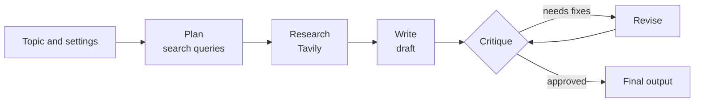

# 🗞️ AI Journalist

A multilingual AI agent that researches the web, then writes and edits articles, blog posts, LinkedIn posts, essays and emails in your language. Built end-to-end, from the agent workflow to a live deployment.

🚀 **Live Demo:** [ai-journalist-nu.vercel.app](https://ai-journalist-nu.vercel.app/)


---

## How it works



1. **Plan**: generates search queries for the topic
2. **Research**: fetches sources from the web using Tavily (can be switched off)
3. **Write**: drafts the piece in the chosen language, tone and length, citing sources
4. **Critique**: an editor step checks language, tone, length and unsupported claims
5. **Revise**: rewrites the draft using the feedback (up to 2 rounds)

---

## Features

- Languages: English, Hindi, Gujarati, Marathi, Bengali, Tamil
- Content types: article, blog post, LinkedIn post, essay, email
- Choice of tone, length and model
- Live progress updates while the agent works
- Sources and editor feedback shown with every result
- Copy or download the output as Markdown
- Bring your own Groq and Tavily keys, or use owner access with a password

---

## Run locally

```bash
git clone https://github.com/krishparmar003/AI-Journalist.git
cd AI-Journalist
python -m venv myenv
myenv\Scripts\activate
pip install -r requirements.txt uvicorn
```

Create a `.env` file:

```
OWNER_PASSWORD=your_long_passphrase
GROQ_API_KEY=your_groq_key
TAVILY_API_KEY=your_tavily_key
```

```bash
uvicorn app:app --reload
```

Open `http://127.0.0.1:8000`. Free keys: [console.groq.com](https://console.groq.com) and [app.tavily.com](https://app.tavily.com).

---

## API keys

- **Visitors** enter their own Groq and Tavily keys in the UI. Keys stay in the browser tab and are only sent with the request.
- **Owner access**: if the correct `OWNER_PASSWORD` is entered, the server uses its own keys from environment variables. Without the password, server keys are never used.

---

## Tech Stack
- **Agent workflow** — LangGraph
- **LLMs** — Groq (GPT-OSS, Qwen) via LangChain
- **Web search** — Tavily
- **Backend** — FastAPI with streaming (SSE)
- **Frontend** — HTML, CSS and vanilla JavaScript
- **Deployment** — Vercel
